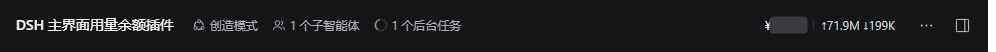
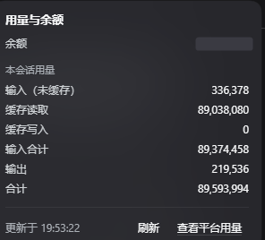

# Usage and balance

A DeepSeek Harness plugin. Adds one readout to the session header (top right,
left of the reminder icon): your DeepSeek account balance beside this session's
token usage.

- **Balance** comes from the signed-in DeepSeek account's recharge and bonus
  wallets through the account service. While the first read is running the
  header shows `余额…`; signed out it shows `未登录` and the popover explains
  where to sign in.
- **Usage** is the provider-reported token total for the current session from
  the `tokenUsage` session projection: input, cache read, cache write, and
  output. The header shows `输入合计` (`↑`) and `输出` (`↓`).
- **Click the readout** for the wallet and per-bucket breakdown, a manual
  refresh, and the Platform usage page.



*The balance amount is masked in this capture.*



*Clicking the readout opens this panel. The balance amount is masked here too.*

## Install

The package root is this repository, so install the directory itself:

1. Clone the repository.
2. In DSH, open **Settings → Plugins → Add plugin** and choose the cloned
   directory, or run:
   ```
   plugin_manager install_bundle <absolute path to the cloned directory>
   ```
3. Restart DSH once. A new client bundle is not live until the process reloads;
   later edits to `client.js` hot-reload on their own.
4. Open any session. The readout appears at the top right of the conversation.

Disable **Usage and balance** under Settings → Plugins to turn it off. No
session data is written by this plugin, so disabling it loses nothing.

## Data and privacy

- **Read**: the account wallet balances (through the host account service) and
  the current session's token counters. Nothing else.
- **Not read**: credentials. The account token stays on the Host; the browser
  half never sees it, and this plugin makes no request of its own. There is no
  `fetch`, no telemetry, no storage, no cookies.
- **Not sent**: nothing leaves the machine because of this plugin. The two
  account queries go to the same Platform endpoints the shipped Account
  settings page already uses.
- **Privilege**: like every DSH client plugin, this code runs with the same
  privileges as the Host UI. It declares only `remote.account` from the Remote
  surface and calls only `getState` and `getBalance`. The source is a single
  unminified file (`client.js`) with no dependencies, so it can be audited in
  one read.

## Behavior

- The balance is read once when the header first mounts, then every five
  minutes while the readout is on screen, when the window regains focus after a
  minute, and on **Refresh**. Each read is one account state query plus one
  balance query; token usage needs no request because the session projection is
  already streamed to the page.
- The readout follows the interface language (Chinese and English) and both
  light and dark themes through the host theme tokens.
- The session header is only drawn while a session is open, so the readout is
  absent on the new-session hero screen.
- The popover's Platform usage link opens in a new tab. In the Desktop app that
  may hand the page to the system browser rather than an in-app view.
- If the readout itself fails to render, the header shows `用量显示失败`
  (`Usage readout failed`) with the cause in its tooltip instead of leaving an
  empty cell; the full error is also logged as `[usage-balance]` in the browser
  console.

## What it does not do

- It does not read the Platform's consumption/billing figures: the installed
  Host exposes wallet balances only, so the Platform usage figure is one click
  away through the popover link instead of being summarized here.
- It does not show a per-turn or per-step history; use the conversation's own
  turn details for that.

## Turn it off

Disable **Usage and balance** under Settings → Plugins (or remove the
`usage-balance` row from the profile patch). No session data is written by this
plugin, so disabling it loses nothing.

## Compatibility

Written against DeepSeek Harness 0.2.2 and its Web client. It relies on three
internal contracts, each of which may change between releases:

- the `conversation.session.header.utilities` list slot (session scope),
- the `tokenUsage` session projection and its four counter fields,
- the client `remote.account` namespace with `getState` and `getBalance`.

It also depends on the shipped `@deepseek-ai/dsh-client-ui-conversation` client
half, declared in `package.json` → `dsh.client.inject` for activation order. If a
future release moves or renames any of these, the readout either disappears
(the declaration never matches) or shows `用量显示失败` (a render failure); it
will not take down the rest of the interface.

## License

MIT — see [LICENSE](LICENSE).
